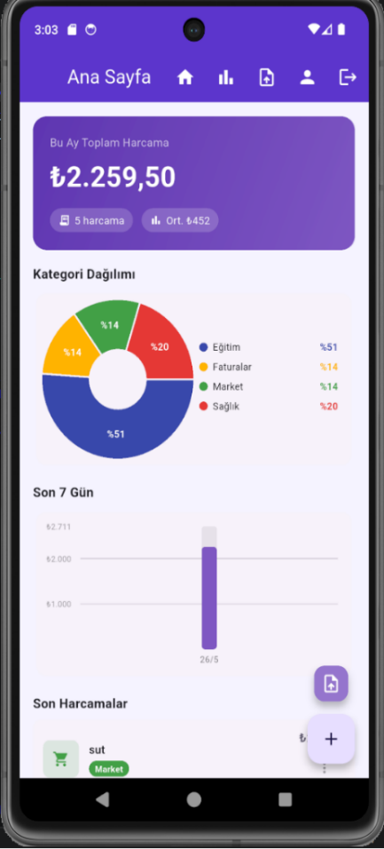
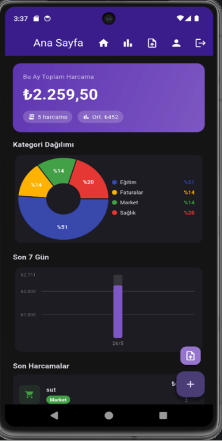
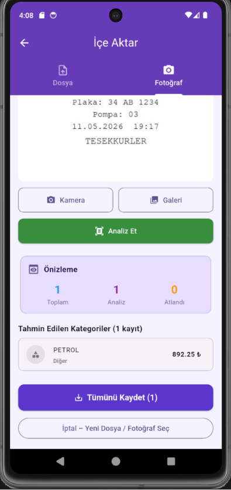
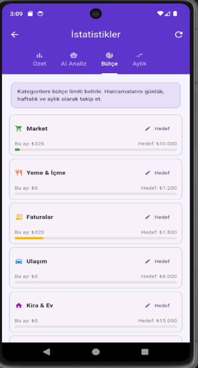
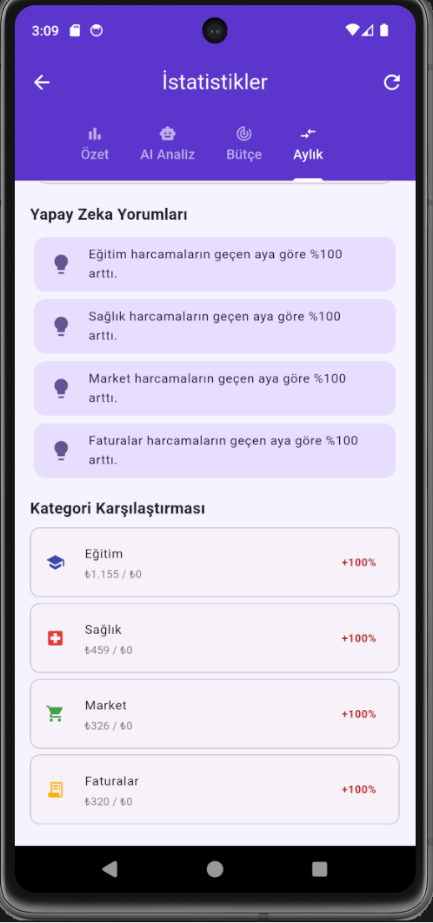
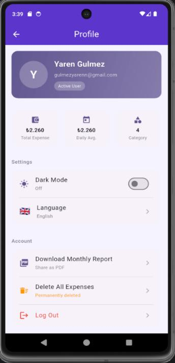
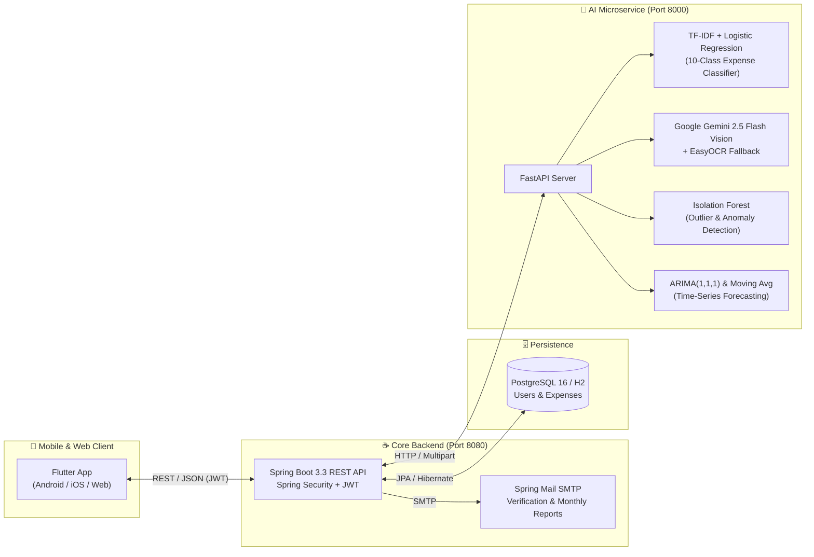

<div align="center">

# 📊 AI-Powered Expense & Receipt Analysis System
### *Yapay Zekâ Destekli Harcama ve Fatura Analiz Sistemi*

**[ 🇬🇧 English](./README.md) | [ 🇹🇷 Türkçe Dokümantasyon](./README.tr.md)**

[](https://flutter.dev)
[](https://spring.io/projects/spring-boot)
[](https://openjdk.org/)
[](https://fastapi.tiangolo.com)
[](https://ai.google.dev)
[](https://www.postgresql.org)
[](https://www.docker.com)
[](./LICENSE)

<p align="center">
  An end-to-end <strong>AI-driven personal finance, receipt OCR, anomaly detection, and time-series forecasting platform</strong> developed as a Computer Engineering Graduation Thesis at <strong>Düzce University</strong>.
</p>

<p align="center">
  <a href="./1.REPORT/Assignment_Report_Ugur_Avsar.pdf"><strong>📄 Thesis Report (PDF)</strong></a> •
  <a href="./2.PRESENTATIONS/05_Final_Defense_Presentation.pdf"><strong>📊 Final Defense Slides</strong></a> •
  <a href="./4.APPLICATION%20FILES/Application/FaturaAnaliz.apk"><strong>📱 Download Android APK</strong></a> •
  <a href="./4.APPLICATION%20FILES/Application/application_video.mp4"><strong>🎬 Demo Video</strong></a> •
  <a href="./5.DOCUMENTS/Documents/User_Manual.pdf"><strong>📘 User Manual</strong></a>
</p>

</div>

---

## 📱 Application Screenshots

| 📊 Dashboard (Light) | 🌙 Dashboard (Dark) | 📸 AI Receipt OCR |
| :---: | :---: | :---: |
|  |  |  |
| **🎯 Category Budget Goals** | **🧠 Monthly AI Insights** | **🌍 Multi-Language & Profile** |
|  |  |  |

---

## 🏗️ System Architecture

The platform is designed with a **3-tier microservice architecture** separating the cross-platform mobile client, the core transactional REST API, and the dedicated Python AI/ML inference engine:



---

## 🧠 AI & Machine Learning Capabilities

| Module | Algorithm / Model | Purpose & Functionality |
| :--- | :--- | :--- |
| **Smart Receipt OCR** | `Google Gemini 2.5 Flash Vision` + `EasyOCR` | Extracts merchant name, date, line items, total amount, and category from receipt photos with an automatic offline fallback to `EasyOCR` + Regex parsing. |
| **Category Classification** | `TF-IDF Vectorizer` + `Logistic Regression` | Predicts expense categories in real time across 10 Turkish/English classes (*Market, Food & Drink, Bills, Transport, Rent & Home, Health, Entertainment, Clothing, Education, Other*) with user feedback loop tracking. |
| **Anomaly Detection** | `Isolation Forest` (`scikit-learn`) | Identifies statistically unusual spending spikes (`contamination=0.1`) and explains the deviation relative to the user's mean and standard deviation (`μ ± 3σ`). |
| **Expense Forecasting** | `ARIMA(1,1,1)` (`statsmodels`) + `SMA` | Forecasts 7-day and 30-day future spending trends with 95% confidence intervals and automatic fallback to Simple Moving Average for sparse data. |
| **3-Month Smart Budgeting** | Trend Heuristics + `Gemini Text Gen` | Analyzes 3-month historical category averages to recommend personalized monthly budget targets and natural-language savings advice. |

---

## 📡 API Overview

### ☕ Spring Boot Backend API (`/api`)
| Method | Endpoint | Description | Auth |
| :--- | :--- | :--- | :---: |
| `POST` | `/api/auth/register` | Register user & send Gmail verification link | Public |
| `POST` | `/api/auth/login` | Authenticate user & issue 24h JWT token | Public |
| `POST` | `/api/auth/forgot-password` | Send 6-digit password reset code via email | Public |
| `GET` | `/api/expenses/dashboard` | Monthly total, 7-day bar stats, category pie stats & recent items | `Bearer JWT` |
| `POST` | `/api/expenses` | Create expense with automatic AI category prediction | `Bearer JWT` |
| `POST` | `/api/expenses/predict` | Live AI category prediction while typing description | `Bearer JWT` |
| `PATCH` | `/api/expenses/{id}/feedback` | Submit user feedback (`accepted: true/false`) on AI prediction | `Bearer JWT` |
| `GET` | `/api/expenses/accuracy` | Confusion matrix & per-category AI prediction accuracy metrics | `Bearer JWT` |
| `GET` | `/api/expenses/full-analysis` | Combined AI anomaly detection, budget risk & ARIMA forecast | `Bearer JWT` |
| `GET` | `/api/expenses/smart-analysis`| Month-over-month category comparison & insights | `Bearer JWT` |
| `POST` | `/api/import/photo` | Upload receipt photo (`JPG`/`PNG`/`WEBP`) for AI OCR preview | `Bearer JWT` |
| `POST` | `/api/import/upload` | Parse bulk expenses from `.csv` / `.xlsx` with AI categorization | `Bearer JWT` |
| `POST` | `/api/import/confirm` | Persist reviewed OCR / CSV / Excel expenses to database | `Bearer JWT` |
| `GET` | `/api/stats/smart-budget` | 3-month historical trend analysis & AI budget recommendations | `Bearer JWT` |

### 🐍 Python FastAPI AI Microservice
| Method | Endpoint | Description |
| :--- | :--- | :--- |
| `POST` | `/predict` | Classify expense description using trained `TF-IDF + LogisticRegression` model |
| `POST` | `/smart-ocr` | Hybrid receipt OCR (`Gemini 2.5 Flash Vision` primary, `EasyOCR` fallback) |
| `POST` | `/anomaly` | Run `IsolationForest` outlier detection on expense amounts |
| `POST` | `/forecast` | Run `ARIMA(1,1,1)` time-series forecasting on daily spending |
| `POST` | `/full-analyze` | Execute anomaly detection, budget advisory, and forecasting in a single call |
| `POST` | `/smart-budget` | Generate 3-month category budget targets and AI summary |

---

## 📁 Repository Structure

```text
ai-expense-receipt-analyzer/
├── 1.REPORT/
│   └── Assignment_Report_Ugur_Avsar.pdf          # Complete 67-Page Graduation Thesis Report
├── 2.PRESENTATIONS/
│   ├── 01_Term_Beginning_Presentation.pdf        # Project Proposal & Scope
│   ├── 02_Literature_Review_Presentation.pdf     # Literature Survey
│   ├── 03_Design_and_Development_Presentation.pdf# System Design & Architecture
│   ├── 04_Result_and_Demo_Presentation.pdf       # Experimental Results & Demo
│   └── 05_Final_Defense_Presentation.pdf         # Final Thesis Defense Presentation
├── 3.SOURCE CODES/
│   └── Source_Code/
│       ├── backend-api/                          # Java 21 + Spring Boot 3.3 REST API
│       ├── ai-service/                           # Python FastAPI ML, ARIMA & OCR Microservice
│       ├── mobile_app/                           # Flutter Multi-Language & Dark Mode App
│       ├── docker-compose.yml                    # Full-Stack Container Orchestration
│       ├── init-db.sql                           # PostgreSQL Schema & Indexes
│       ├── start-all.ps1                         # One-Click Windows Startup Script
│       └── stop.ps1                              # Service Shutdown Script
├── 4.APPLICATION FILES/
│   └── Application/
│       ├── FaturaAnaliz.apk                      # Compiled Android Release APK
│       └── application_video.mp4                 # Application Walkthrough & Demo Video
├── 5.DOCUMENTS/
│   └── Documents/
│       ├── Installation_Instructions.pdf         # Step-by-Step Setup Guide
│       ├── User_Manual.pdf                       # End-User Manual
│       └── License_Information.txt               # Third-Party Licenses & Attribution
├── docs/screenshots/                             # UI Screenshots for Documentation
├── LICENSE                                       # MIT License
├── README.md                                     # English Documentation
└── README.tr.md                                  # Turkish Documentation
```

---

## ⚙️ Getting Started (Local Development)

### Option 1: Run with Docker Compose (Recommended)

```bash
cd "3.SOURCE CODES/Source_Code"
export GEMINI_API_KEY="your_gemini_api_key_here"
docker compose up --build -d
```

Once the containers are running locally, the services listen on the following local ports:
- **Backend REST API:** `http://localhost:8080/api` (Swagger UI: `/api/swagger-ui.html`)
- **AI Microservice:** `http://localhost:8000` (OpenAPI Docs: `/docs`)
- **PostgreSQL Database:** `localhost:5432` (`fatura_db`)

### Option 2: Run Manually from Source

#### 1. Start the AI Microservice (Port `8000`)
```bash
cd "3.SOURCE CODES/Source_Code/ai-service"
python -m venv venv
source venv/bin/activate        # Windows: .\venv\Scripts\activate
pip install -r requirements.txt
cp .env.example .env            # Add your GEMINI_API_KEY in .env
python main.py
```

#### 2. Start the Spring Boot Backend (Port `8080`)
```bash
cd "3.SOURCE CODES/Source_Code/backend-api"
./mvnw spring-boot:run          # Runs with H2 profile by default for zero-config setup
```

#### 3. Run the Flutter Mobile App
```bash
cd "3.SOURCE CODES/Source_Code/mobile_app"
flutter pub get
flutter run
```

---

## 👤 Author & Academic Information

- **Author:** Uğur Avşar
- **Advisor:** Dr. Büşra Takgil
- **Institution:** Düzce University — Department of Computer Engineering
- **Contact:** uguravsar10@gmail.com

## 📄 License

Distributed under the **MIT License**. See [`LICENSE`](./LICENSE) and [`5.DOCUMENTS/Documents/License_Information.txt`](./5.DOCUMENTS/Documents/License_Information.txt) for more information.
