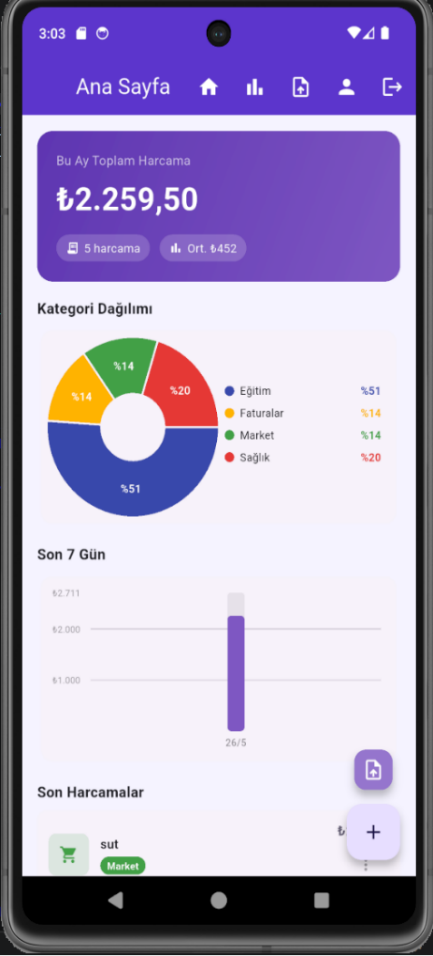
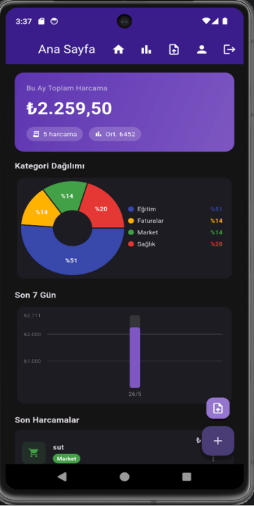
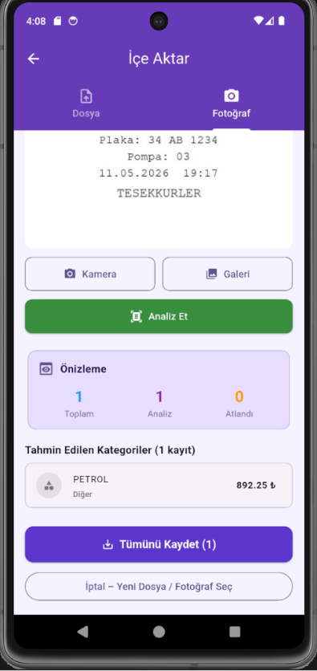
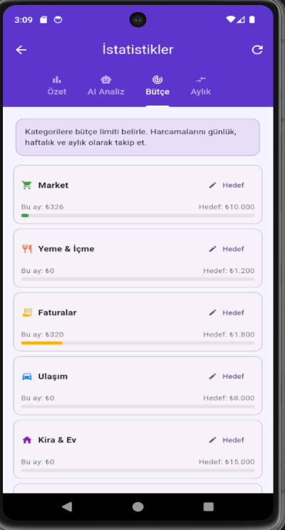
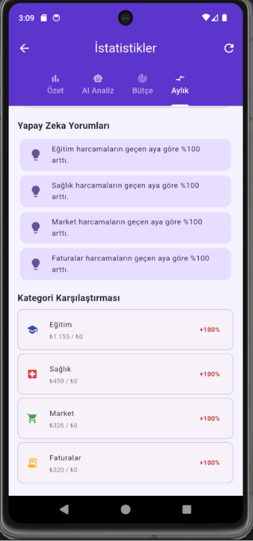
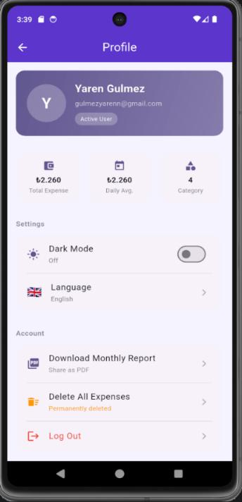
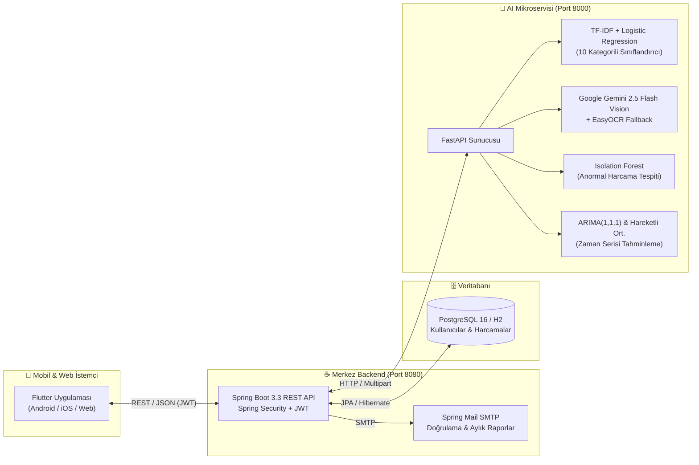

<div align="center">

# 📊 Yapay Zekâ Destekli Harcama ve Fatura Analiz Sistemi
### *AI-Powered Expense & Receipt Analysis System*

**[ 🇬🇧 English Documentation](./README.md) | [ 🇹🇷 Türkçe](./README.tr.md)**

[](https://flutter.dev)
[](https://spring.io/projects/spring-boot)
[](https://openjdk.org/)
[](https://fastapi.tiangolo.com)
[](https://ai.google.dev)
[](https://www.postgresql.org)
[](https://www.docker.com)
[](./LICENSE)

<p align="center">
  <strong>Düzce Üniversitesi Bilgisayar Mühendisliği Bölümü</strong> bitirme tezi kapsamında geliştirilmiş; fiş/fatura görsellerini yapay zekâ ile okuyan, harcamaları otomatik sınıflandıran, anomali tespiti ve zaman serisi (ARIMA) bütçe tahminlemesi yapan uçtan uca mobil ve mikroservis platformu.
</p>

<p align="center">
  <a href="./1.REPORT/Assignment_Report_Ugur_Avsar.pdf"><strong>📄 Tez Raporu (PDF)</strong></a> •
  <a href="./2.PRESENTATIONS/05_Final_Defense_Presentation.pdf"><strong>📊 Final Savunma Sunumu</strong></a> •
  <a href="./4.APPLICATION%20FILES/Application/FaturaAnaliz.apk"><strong>📱 Android APK İndir</strong></a> •
  <a href="./4.APPLICATION%20FILES/Application/application_video.mp4"><strong>🎬 Demo Videosu</strong></a> •
  <a href="./5.DOCUMENTS/Documents/User_Manual.pdf"><strong>📘 Kullanım Kılavuzu</strong></a>
</p>

</div>

---

## 📱 Uygulama Ekran Görüntüleri

| 📊 Ana Sayfa (Açık Tema) | 🌙 Ana Sayfa (Karanlık Mod) | 📸 AI Fiş / Fatura Okuma |
| :---: | :---: | :---: |
|  |  |  |
| **🎯 Kategori Bütçe Hedefleri** | **🧠 Aylık AI Yorumları** | **🌍 Çoklu Dil & Profil** |
|  |  |  |

---

## 🏗️ Sistem Mimarisi

Platform; çoklu platform destekli Flutter mobil istemcisi, JWT güvenliğine sahip Spring Boot merkezi REST API'si ve makine öğrenmesi/görüntü işleme görevlerini yürüten Python FastAPI mikroservisinden oluşan **3 katmanlı mikroservis mimarisi** ile tasarlanmıştır:



---

## 🧠 Yapay Zekâ ve Makine Öğrenmesi Modülleri

| Modül | Algoritma / Model | Görev ve İşleyiş |
| :--- | :--- | :--- |
| **Akıllı Fiş/Fatura Okuma** | `Google Gemini 2.5 Flash Vision` + `EasyOCR` | Fiş fotoğraflarından işyeri adı, tarih, ürünler, toplam tutar ve kategoriyi çıkarır. Gemini API erişimi olmadığında otomatik olarak `EasyOCR` + Regex motoruna geçer. |
| **Otomatik Kategori Tahmini** | `TF-IDF Vectorizer` + `Logistic Regression` | Harcama açıklamalarından 10 kategori (*Market, Yeme & İçme, Faturalar, Ulaşım, Kira & Ev, Sağlık, Eğlence, Giyim, Eğitim, Diğer*) arasında anlık tahmin yapar ve kullanıcı geri bildirimiyle doğruluk oranını ölçer. |
| **Anomali Tespiti** | `Isolation Forest` (`scikit-learn`) | Kullanıcının normal harcama dağılımından sapan olağan dışı harcamaları (`contamination=0.1`) ve standart sapma farklarını (`μ ± 3σ`) tespit ederek uyarır. |
| **Zaman Serisi Tahminleme** | `ARIMA(1,1,1)` (`statsmodels`) + `SMA` | Günlük harcama geçmişinden gelecek 7 ve 30 günlük harcama projeksiyonunu ve %95 güven aralığını hesaplar. |
| **3 Aylık Akıllı Bütçe Önerisi** | Trend Analizi + `Gemini Text Gen` | Son 3 aylık kategori ortalamalarını karşılaştırarak artış/azalış trendini bulur ve kategori bazında aylık bütçe hedefleri önerir. |

---

## 📡 API Uç Noktaları (Endpoints)

### ☕ Spring Boot Backend API (`/api`)
| Metod | Endpoint | Açıklama | Yetki |
| :--- | :--- | :--- | :---: |
| `POST` | `/api/auth/register` | Kullanıcı kaydı ve Gmail doğrulama e-postası gönderimi | Açık |
| `POST` | `/api/auth/login` | Kullanıcı girişi ve 24 saatlik JWT token üretimi | Açık |
| `POST` | `/api/auth/forgot-password` | E-posta ile 6 haneli şifre sıfırlama kodu gönderimi | Açık |
| `GET` | `/api/expenses/dashboard` | Aylık toplam, son 7 gün grafiği, kategori dağılımı ve son harcamalar | `Bearer JWT` |
| `POST` | `/api/expenses` | Yeni harcama ekleme ve otomatik AI kategori tahmini | `Bearer JWT` |
| `POST` | `/api/expenses/predict` | Açıklama yazılırken canlı AI kategori tahmini | `Bearer JWT` |
| `PATCH` | `/api/expenses/{id}/feedback` | AI kategori tahminine kullanıcı onayı/düzeltmesi (`accepted`) | `Bearer JWT` |
| `GET` | `/api/expenses/accuracy` | AI tahminlerinin genel ve kategori bazlı doğruluk istatistikleri | `Bearer JWT` |
| `GET` | `/api/expenses/full-analysis` | Anomali tespiti, bütçe riski ve ARIMA tahmini birleşik analizi | `Bearer JWT` |
| `GET` | `/api/expenses/smart-analysis`| Geçen ay ve bu ayın kategori bazlı karşılaştırma analizi | `Bearer JWT` |
| `POST` | `/api/import/photo` | Fiş/fatura fotoğrafı (`JPG`/`PNG`/`WEBP`) yükleme ve AI OCR önizleme | `Bearer JWT` |
| `POST` | `/api/import/upload` | `.csv` / `.xlsx` dosyasından toplu harcama okuma ve AI sınıflandırma | `Bearer JWT` |
| `POST` | `/api/import/confirm` | Önizlenen fiş veya tablo harcamalarını veritabanına kaydetme | `Bearer JWT` |
| `GET` | `/api/stats/smart-budget` | Son 3 aylık kategori geçmişine göre AI destekli bütçe tavsiyesi | `Bearer JWT` |

---

## 📁 Proje Klasör Yapısı

```text
ai-expense-receipt-analyzer/
├── 1.REPORT/
│   └── Assignment_Report_Ugur_Avsar.pdf          # 67 Sayfalık Bitirme Tezi Raporu
├── 2.PRESENTATIONS/
│   ├── 01_Term_Beginning_Presentation.pdf        # Dönem Başı Sunumu
│   ├── 02_Literature_Review_Presentation.pdf     # Literatür Taraması Sunumu
│   ├── 03_Design_and_Development_Presentation.pdf# Tasarım ve Geliştirme Sunumu
│   ├── 04_Result_and_Demo_Presentation.pdf       # Sonuç ve Demo Sunumu
│   └── 05_Final_Defense_Presentation.pdf         # Final Tez Savunma Sunumu
├── 3.SOURCE CODES/
│   └── Source_Code/
│       ├── backend-api/                          # Java 21 + Spring Boot 3.3 REST API
│       ├── ai-service/                           # Python FastAPI ML, ARIMA & OCR Servisi
│       ├── mobile_app/                           # Flutter Çoklu Dil & Karanlık Mod Uygulaması
│       ├── docker-compose.yml                    # Docker Compose Orkestrasyonu
│       ├── init-db.sql                           # PostgreSQL Tablo ve İndeks Şeması
│       ├── start-all.ps1                         # Tek Tıkla Başlatma Betiği (Windows)
│       └── stop.ps1                              # Servis Durdurma Betiği
├── 4.APPLICATION FILES/
│   └── Application/
│       ├── FaturaAnaliz.apk                      # Derlenmiş Android Kurulum Paketi (APK)
│       └── application_video.mp4                 # Uygulama Tanıtım ve Demo Videosu
├── 5.DOCUMENTS/
│   └── Documents/
│       ├── Installation_Instructions.pdf         # Kurulum Kılavuzu (PDF)
│       ├── User_Manual.pdf                       # Kullanıcı Kılavuzu (PDF)
│       └── License_Information.txt               # Lisans ve Kütüphane Bilgileri
├── docs/screenshots/                             # Uygulama Arayüz Ekran Görüntüleri
├── LICENSE                                       # MIT Lisansı
├── README.md                                     # İngilizce Dokümantasyon
└── README.tr.md                                  # Türkçe Dokümantasyon
```

---

## ⚙️ Kurulum ve Çalıştırma

### Seçenek 1: Docker Compose ile Çalıştırma (Önerilen)

```bash
cd "3.SOURCE CODES/Source_Code"
export GEMINI_API_KEY="sizin_gemini_api_anahtariniz"
docker compose up --build -d
```

Konteynerler ayağa kalktığında yerel ortamda aşağıdaki portlar üzerinden hizmet verir:
- **Backend REST API:** `http://localhost:8080/api` (Swagger UI: `/api/swagger-ui.html`)
- **AI Mikroservisi:** `http://localhost:8000` (OpenAPI Docs: `/docs`)
- **PostgreSQL Veritabanı:** `localhost:5432` (`fatura_db`)

### Seçenek 2: Kaynak Koddan Manuel Çalıştırma

#### 1. AI Servisi (Port `8000`)
```bash
cd "3.SOURCE CODES/Source_Code/ai-service"
python -m venv venv
source venv/bin/activate        # Windows: .\venv\Scripts\activate
pip install -r requirements.txt
cp .env.example .env            # .env içine GEMINI_API_KEY değerinizi girin
python main.py
```

#### 2. Backend API (Port `8080`)
```bash
cd "3.SOURCE CODES/Source_Code/backend-api"
./mvnw spring-boot:run
```

#### 3. Mobil Uygulama (Flutter)
```bash
cd "3.SOURCE CODES/Source_Code/mobile_app"
flutter pub get
flutter run
```

---

## 👤 Geliştirici ve Akademik Bilgiler

- **Geliştirici:** Uğur Avşar
- **Tez Danışmanı:** Dr. Büşra Takgil
- **Kurum:** Düzce Üniversitesi — Bilgisayar Mühendisliği Bölümü
- **İletişim:** uguravsar10@gmail.com

## 📄 Lisans

Bu proje **MIT Lisansı** altında lisanslanmıştır. Detaylar için [`LICENSE`](./LICENSE) ve [`5.DOCUMENTS/Documents/License_Information.txt`](./5.DOCUMENTS/Documents/License_Information.txt) dosyalarını inceleyebilirsiniz.
